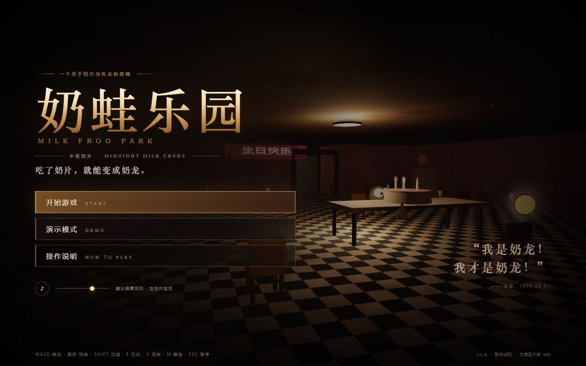
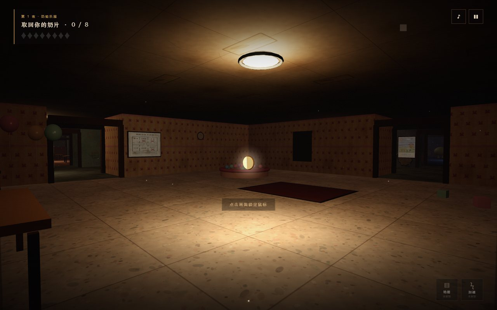
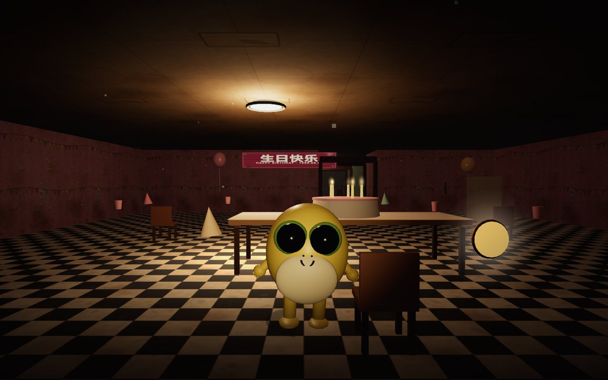
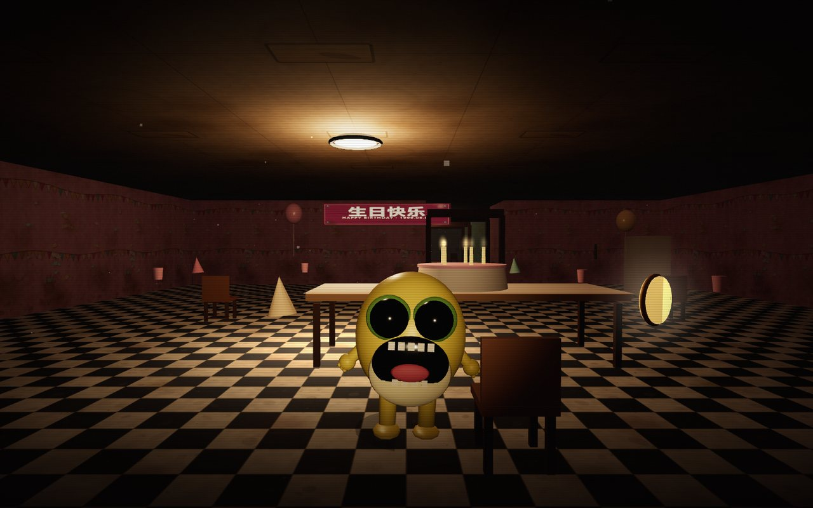
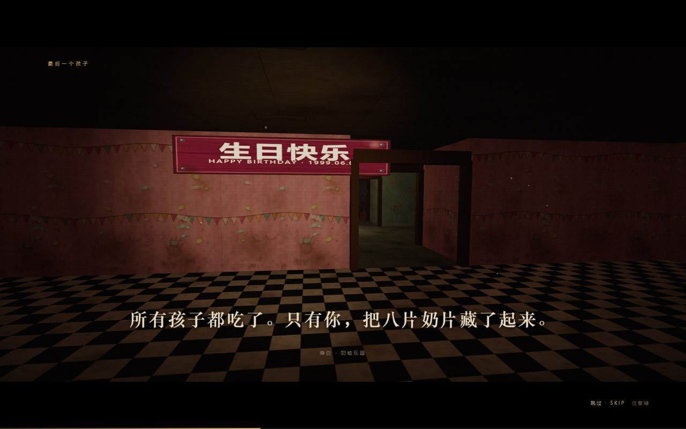

# 奶蛙乐园：午夜奶片

**Milk Frog Park: Midnight Milk Candy**

> 第一人称、温馨又惊悚的 3D 迷宫游戏。在废弃的「奶蛙乐园」收集八片奶片，躲开一直跟着你的奶蛙，从安全出口离开。

技术栈 **HTML / CSS / JavaScript + Three.js**；无构建、无后端、可离线运行；运行时依赖 Python 3 静态服务器。

[可玩 URL](#2-可玩-url) · [本地运行与发布](#3-本地运行与发布) · [已知限制](#4-已知限制) · [源代码、资源与 AI 致谢](#5-源代码资源与-ai-致谢) · [Contributors](#6-contributors) · [HANDOFF.md](HANDOFF.md)

---

## 1. 目的与控制方式

### 1.1 目的

Week 05 小组作业《3D Game》的可运行源码。儿童乐园装潢与追击型奶蛙、意识值、幻觉构成「温馨又惊悚」的反差体验。单关卡，单局 3–6 分钟，面向 PC 键鼠玩家的独立小游戏。几何、贴图与音频全部本机生成，不依赖 CDN、账号或密钥。

奶蛙形象是网络迷因（被魔改的「奶龙」表情包）的同人二创，不使用官方素材。

### 1.2 一局怎么玩

1. 找到 **8 片奶片**（贴地发光的圆片）。
2. 集满 **3 片** → 解锁 **乐园地图**（左下角小地图）。
3. 集满 **6 片** → 解锁 **加速 / 糖分**（SHIFT 冲刺）。
4. 集满 **8 片** → 出口厅的 **安全出口** 打开。
5. 走到出口前按 **E** → 通关。

奶蛙：

- 4 只，3 种体型（小奶蛙 / 胖奶蛙 / 长腿奶蛙），游荡并追人；被玩家主动逼近时后退。
- 身体为组员提供的 `assets/models/nailong_colored_2.0.glb`（原创静态网格，无骨骼）；加载失败时回退为程序化奶蛙。
- 正常速度下追不上也甩不掉；玩家静止或被堵住时会被贴身，判定失败；冲刺可让它们短暂眩晕。
- 距离越近，「我是奶龙！我才是奶龙！」越响，心跳与红色暗角越重。

失败进入「你被找到了」结算页；ESC 暂停可继续 / 重新开始 / 返回主菜单；重开清空本局进度。

### 1.3 意识值与龙奶

- 从 100% 起随时间下降（幻觉期间暂停），约 2 分钟归零；暂停或窗口失焦时停止计时。
- 低于 20% 与 10% 各触发一次幻觉（画面 7 秒、音效 8 秒），归零即失败；幻觉不影响操作。
- 降至 50% 时地图随机出现 3 瓶龙奶，靠近自动拾取，每瓶 +20%，冷却 10 秒，不显示在小地图上。

### 1.4 演示模式（Demo）

主菜单 **「演示模式 / DEMO」**：脚本操作真实游戏自动游玩约 2.5 分钟（24 片奶片，142–157 秒通关），结束显示胜利结算并回主菜单，ESC 可退出。场景、HUD、AI、声音与胜负逻辑与真人相同。

### 1.5 操作按键

| 按键                | 作用                   |
| ----------------- | -------------------- |
| **W A S D** / 方向键 | 移动                   |
| **鼠标**            | 转动视角（点击画面锁定鼠标）       |
| **SHIFT**         | 冲刺（集满 6 片后解锁，消耗「糖分」） |
| **空格**            | 跳跃                   |
| **E**             | 互动 / 在安全出口离开         |
| **V**             | 第一人称 / 第三人称切换        |
| **F**             | 手电筒                  |
| **M**             | 静音 / 取消静音            |
| **ESC**           | 暂停                   |

输入方式：桌面键盘 + 鼠标。

### 1.6 内部通道（开发用）

无奶蛙、不扣意识值、可穿墙飞行的排查模式。入口：主菜单右下角 **内部通道 · INTERNAL**，或 `?channel=internal`（等价 `?inspect=1`）。

| 按键                       | 作用                                |
| ------------------------ | --------------------------------- |
| **W A S D** / 方向键        | 朝视线方向飞行（无碰撞、无重力）                  |
| **空格** / **Q**           | 上升                                |
| **C** / **E** / **Ctrl** | 下降                                |
| **SHIFT**                | 加速 2.6 倍                          |
| **滚轮** / **[** **]**     | 飞行速度 1–30 m/s                     |
| **1 – 6**                | 跳到 门厅 / 教室 / 园长室 / 午睡室 / 食堂 / 出口厅 |
| **R**                    | 重新扫描                              |
| **B**                    | 问题标记框                             |
| **N**                    | 墙体半透明                             |
| **G**                    | 地面格网                              |
| **L**                    | 体检灯光                              |
| **H**                    | 左侧面板                              |
| **I**                    | 列出「参考」级吊挂装饰                       |
| **ESC**                  | 退出通道                              |

左侧面板显示坐标、朝向、速度与扫描结果（红：问题；黄：可疑缝隙；灰：吊挂装饰）；点击条目镜头飞到对应物件。

```bat
node tools/channel/audit.mjs --shots=1
```

---

## 2. 可玩 URL

| 用途                 | 地址                                                  | 备注                              |
| ------------------ | --------------------------------------------------- | ------------------------------- |
| 线上试玩（GitHub Pages） | https://147258369-cwb.github.io/milk-frog-park-w05/ | 尚未发布                            |
| 本地试玩               | http://127.0.0.1:8000/                              | 由 `serve.py` 提供                 |
| 源码仓库               | https://github.com/147258369-cwb/milk-frog-park-w05 | 旧名 `starfall-salvage-w05` 自动重定向 |

仓库根目录即站点根，线上与本地内容一致。首屏加载约 9.3 MB 音频（27 条 WAV）。

---

## 3. 本地运行与发布

### 3.1 本地运行

```bat
cd <本目录>
python serve.py 8000
```

入口 http://127.0.0.1:8000/；Windows 下等价入口为 `run_game.bat`。Three.js 0.160.0 已放在 `vendor/three.module.js`，运行时不联网。

### 3.2 发布到 GitHub Pages

静态托管，无构建步骤。

| 设置项    | 取值                   |
| ------ | -------------------- |
| Source | Deploy from a branch |
| Branch | `main`               |
| Folder | `/`（root）            |

GitHub Pages 为 Linux 静态托管，文件名区分大小写；页面经 CDN 缓存。

### 3.3 打包运行包

```bat
python tools/package_submission.py
```

产物为 `release/w05_3d_game/`（源码、`vendor/`、`assets/`、依赖清单与 README，相对路径不变），不含 `node_modules/`、`tools/`、`release/`。

---

## 4. 已知限制

**玩法**

- 单关卡；「震荡 / 磁铁」未实现。
- 无存档，只有音量与静音写入 localStorage。
- 仅桌面键鼠，无手柄与移动端。

**画面**

- 程序化低多边形风格；低端显卡与软件渲染下帧率下降。
- 奶蛙为静态 GLB 模型，无骨骼动画，行走靠整体摇摆。
- 场景仍有建模重叠、局部错位与贴图接缝；片头镜头偶有轻微穿模，切到可操作较生硬。
- 个别区域（午睡室、出口厅）偏暗，贴图未做人眼终审。

**音频**

- 旁白与奶蛙音效未做人耳终审，音量平衡可能需微调。
- `frog_voice_1` 来自 Bilibili 音频裁剪；`assets/audio/nai_long.mp3` 游戏内未播放但仍随 manifest 预加载（约 0.56 MB）。公开分发前需确认授权或移除。
- 本地 Windows TTS 会把 SSML 音高量化，语速只有固定档位。

**运行环境**

- 直接以 `file://` 打开 `index.html` 无法运行：ES Module 与 `fetch()` 被浏览器拦截。需经 HTTP 静态服务访问。
- 浏览器自动播放策略要求首次交互后才出声。
- Pointer Lock 在个别系统上首次点击可能不生效。
- 自动化验收为 Microsoft Edge (Chromium) headless + Playwright Core，三档分辨率；Chrome / Edge 桌面版预期可用，Firefox / Safari 未测。验收用 SwiftShader 软件渲染，只覆盖「能运行、无报错、流程可走通」。
- 内部通道扫描为几何近似，复合道具需显式标 `userData.channelFloatOk` 才不误报。

**发布与部署**

- GitHub Pages 为 Linux 静态托管、**不运行任何后端**；本游戏无服务端逻辑，可部署到 Pages，但任何需要服务器或接口的能力都无法在 Pages 上运行。
- 页面经 CDN 缓存，仓库更新后线上需**数分钟**才生效；验证前应先确认部署已完成，必要时强制刷新。
- 首屏加载约 **9.3 MB 音频**（27 条 WAV），弱网或低配设备下加载较慢；本项目仅面向桌面键鼠，未做移动端适配。
- 仅「部署成功」或「自动化验收通过」**不代表游戏可玩**：自动化只覆盖「能运行、无报错、流程可走通」，开始 / 操作 / 进度 / 重启 / 声音与免登录打开仍需真人验证。
- 公开分发前需确认 `frog_voice_1` 人声授权，并处理随 manifest 预加载的 `assets/audio/nai_long.mp3`（约 0.56 MB，游戏内未播放）。

---

## 5. 源代码、资源与 AI 致谢

### 5.1 目录结构

```text
.
├─ index.html            # 页面结构 / 菜单 / HUD / 剧情 / 结算
├─ styles.css            # 视觉系统
├─ serve.py              # 零依赖本地静态服务器（Python 3）
├─ run_game.bat          # Windows 启动入口
├─ package.json          # 依赖清单
├─ pnpm-lock.yaml        # 锁定文件（开发期）
├─ vendor/               # Three.js r160 + GLTFLoader + BufferGeometryUtils
├─ src/
│  ├─ main.js            # 状态机、相机与渲染循环
│  ├─ config.js          # 地图布局、位置、剧情文本、数值
│  ├─ world.js           # 迷宫、6 个区域、家具、灯光、奶片、出口
│  ├─ player.js          # 视角、碰撞、体力、跳跃、手电
│  ├─ frogs.js           # 奶蛙模型、追逐、眩晕、距离音效
│  ├─ textures.js        # 程序化 Canvas 贴图
│  ├─ textures-fallback.js # 贴图兜底
│  ├─ audio.js           # WebAudio 管理
│  ├─ ui.js              # 菜单、HUD、小地图、字幕、结算
│  ├─ story.js           # 片头镜头与字幕
│  ├─ demo.js            # 演示模式机器人
│  └─ inspect.js         # 内部通道
├─ assets/
│  ├─ models/nailong_colored_2.0.glb
│  └─ audio/             # 27 条 WAV + manifest.json
├─ docs/                 # 音频、贴图、契约、验收、场景审计、截图
├─ tools/                # 开发与验收工具（不参与运行时）
├─ W05_GroupID.md        # 小组作业报告
└─ HANDOFF.md            # 交接文档
```

### 5.2 依赖与许可

| 组件                   | 位置                                          | 许可         |
| -------------------- | ------------------------------------------- | ---------- |
| Three.js r160        | `vendor/three.module.js`                    | MIT        |
| GLTFLoader           | `vendor/three/loaders/GLTFLoader.js`        | MIT        |
| BufferGeometryUtils  | `vendor/three/utils/BufferGeometryUtils.js` | MIT        |
| Playwright Core（开发期） | `package.json` devDependency                | Apache-2.0 |

运行时无外部字体、图标库与分析脚本。

### 5.3 素材来源与署名

| 资源                                   | 来源                                 | 署名 / 说明              |
| ------------------------------------ | ---------------------------------- | -------------------- |
| 场景几何、灯光、特效                           | 本组代码生成                             | 仓库源码                 |
| Canvas 贴图（墙 / 地 / 顶 / 海报 / 标牌 / 奶蛙脸） | `src/textures.js` 程序化生成            | 见 `docs/TEXTURES.md` |
| 27 条音频（音乐 / 环境 / SFX / 旁白）           | Windows 中文 TTS + Python / NumPy 合成 | 见 `docs/AUDIO.md`    |
| `frog_voice_1` 追击人声                  | 组员提供的自然录音（Bilibili 裁剪）             | 公开分发前需确认授权           |
| 奶蛙模型 `nailong_colored_2.0.glb`       | 组员提供的原创低多边形模型                      | 非官方素材                |
| 「奶龙 / 奶蛙」形象                          | 网络迷因的同人二创                          | 不使用官方角色素材            |

### 5.4 AI 致谢

- AI 编码代理 **DeepSeek Harness / deepseek-v4-1-flash** 参与代码、程序化贴图、音频流水线、验收脚本与文档初稿。
- 所有 AI 产出经本地运行、截图或数值自检后才保留（契约断言、headless 验收、场景审计）。
- 致谢：Three.js 及示例模块作者；Windows 中文 TTS（Microsoft OneCore）；提供迷因来源的网络社区。

---

## 6. Contributors

| 贡献者             | 角色 / 实际工作 | 保留的署名 / 资源 |
| --------------- | --------- | ---------- |
| `147258369-cwb` | 待填写       | 待填写        |
| 待填写             | 待填写       | 待填写        |
| 待填写             | 待填写       | 待填写        |

---

## 附录 A 测试与验收

- **环境**：Microsoft Edge (Chromium) 155.0.4283.62 headless + Playwright Core 1.64.1，1440×900 / 1280×720 / 1920×1080。
- **结果**：自动化 QA **64/64 通过**，0 console error / 0 pageerror，164 个请求全部同源。
- **场景审计**：几何问题的扫描结果见 `docs/scene-audit-static.md`；复查入口见 1.6 内部通道。

---

## 附录 B 预览

| 主菜单                               | 游玩                               |
| --------------------------------- | -------------------------------- |
|  |  |

| 奶蛙 · 常态                          | 奶蛙 · 靠近时                                 |
| -------------------------------- | ---------------------------------------- |
|  |  |

| 片头剧情                              | 被抓 Jumpscare                                 |
| --------------------------------- | -------------------------------------------- |
|  |  |
