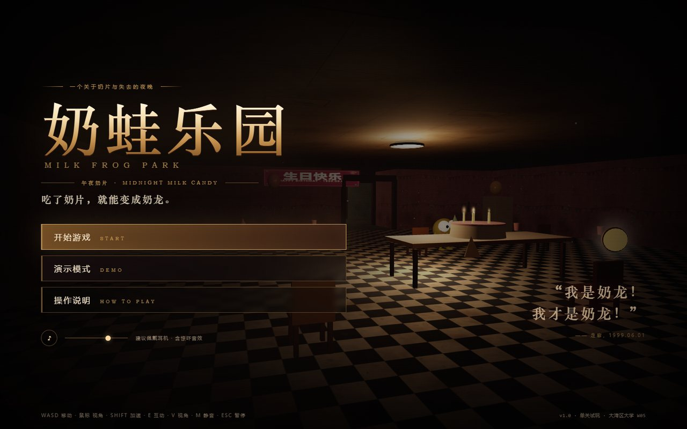
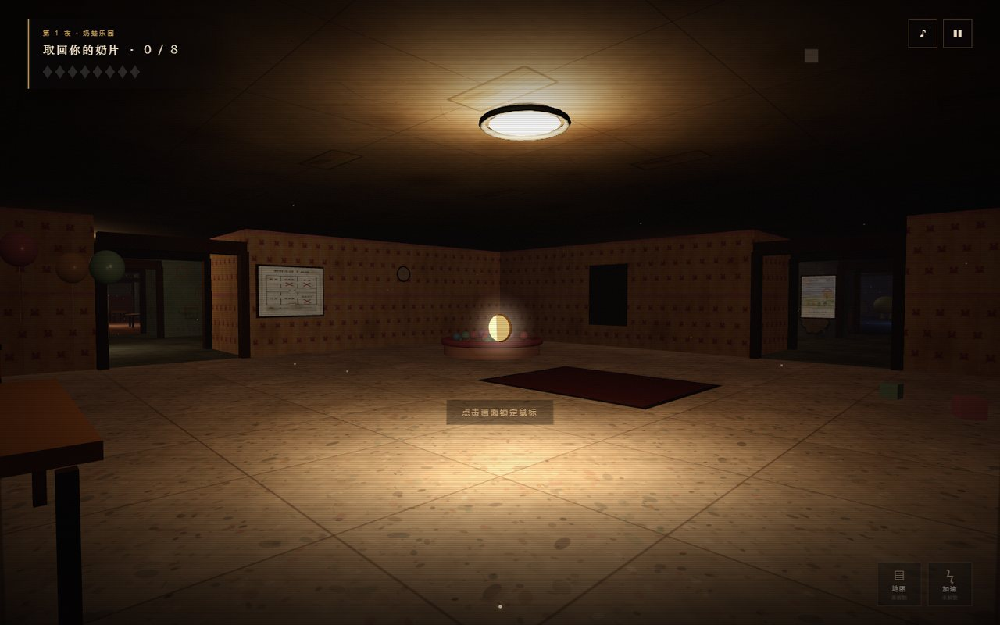
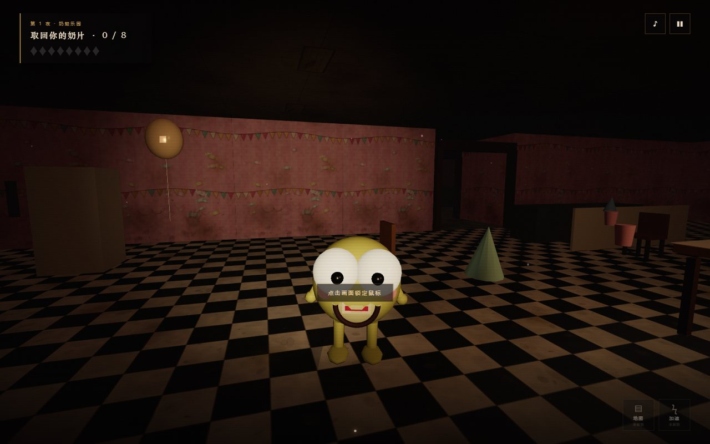
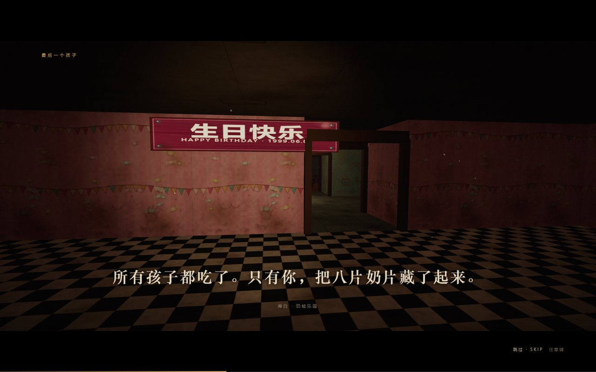

# 奶蛙乐园：午夜奶片
**Milk Frog Park: Midnight Milk Candy**

> 一款第一人称、温馨又惊悚的 3D 迷宫游戏。  
> 在废弃的奶蛙乐园里收集八片奶片，带着它们从安全出口离开——别停下，它们还记得你的味道。

> **一句话目标：** 在乐园被推平的前夜回到废弃的「奶蛙乐园」迷宫，找到并带走 8 片奶片，躲开一直跟着你的奶蛙，从安全出口活着离开。

本仓库为 Week 05 小组作业《3D Game》的可运行源码。使用 **HTML / CSS / JavaScript + Three.js**，无需构建、无需联网、无需后端。

---

## 1. 快速开始

### 方式 A：双击（Windows）
双击 `run_game.bat`。它会用 Python 启动本地静态服务器并打开浏览器。

### 方式 B：命令行
```bat
cd <本目录>
python serve.py 8000
```
然后打开 **http://127.0.0.1:8000/**

> **必须通过 http:// 打开**。ES Module 与 `fetch()` 音频在 `file://` 下会被浏览器拦截，直接双击 `index.html` 会黑屏。  
> 需要 Python 3（仅用标准库）；也可以改用任意静态文件服务器，只要把仓库根目录作为站点根。  
> **无需联网、无需 npm install**：Three.js 0.160.0 已 vendor 在 `vendor/three.module.js`，运行时不访问 CDN、不调用 AI 服务。

首次加载会下载并解码约 9.3 MB 的 WAV 音频，通常 2–6 秒；加载页显示进度。

---

## 2. 操作

| 按键 | 作用 |
|---|---|
| **W A S D** / 方向键 | 移动 |
| **鼠标** | 转动视角（点击画面锁定鼠标） |
| **SHIFT** | 加速冲刺（收集 6 片奶片后解锁，消耗「糖分」） |
| **E** | 互动 / 在安全出口离开 |
| **V** | 第一人称 / 第三人称切换（第三人称可看到主角形象） |
| **F** | 手电筒开关 |
| **M** | 静音 / 取消静音 |
| **ESC** | 暂停（继续 / 重新开始 / 返回主菜单） |

鼠标未锁定时，画面中央会提示「点击画面锁定鼠标」。

---

## 3. 目标与一局流程

1. 在乐园里找到 **8 片奶片**（贴地发光的圆片；解锁地图后小地图上也会显示金色标记）。
2. 收集到 **3 片** → 解锁 **乐园地图**（左下角小地图，显示房间、奶片与附近奶蛙）。
3. 收集到 **6 片** → 解锁 **加速 / 糖分**（按住 SHIFT 冲刺，可甩开奶蛙）。
4. 收集到 **8 片** → 出口厅的 **安全出口** 打开。
5. 走到出口前按 **E** → 通关。

奶蛙：
- 共 4 只，3 种体型/速度（小奶蛙、胖奶蛙、长腿奶蛙），一直在地图里游荡并追着你。
- 正常行走时它们追不上你，但也甩不掉；**站着不动**或**被堵住**时它们会靠近，贴脸即失败。
- 冲刺可以把它们甩到「眩晕」状态，暂时失去目标。
- 靠近时「我是奶龙！我才是奶龙！」会越来越响，心跳与红色暗角也会加重。

**失败 / 暂停 / 重开：** 被抓后进入「你被找到了」结算页，可「再试一次」或回主菜单；按 ESC 暂停可「继续 / 重新开始 / 返回主菜单」；重开会清空本局奶片与解锁进度（没有存档，每局从头开始）；通关后可「再玩一次」或回主菜单。

---

## 4. 演示模式（Demo）

主菜单点击 **「演示模式 / DEMO」**：

- 无需任何输入，脚本会操作**真实游戏**自动游玩约 **50–60 秒**（自动化模拟实测 51.4 秒通关）；
- 自动收集奶片、解锁地图与加速、被奶蛙追近、冲刺甩开、最后从安全出口离开；
- 演示结束显示胜利结算，约 5 秒后自动返回主菜单；
- 演示过程中按 **ESC** 可立即退出回主菜单。

Demo 使用与真人游玩完全相同的场景、HUD、AI、声音与胜负逻辑，不是预录视频。

---

## 5. 声音

- 主菜单 / 暂停界面都有**音量滑条**和静音按钮；游戏内按 **M** 键可静音（HUD 右上角有提示）。
- **浏览器要求用户先点击页面才允许出声**（AudioContext 自动播放策略）：进入菜单后点击一下页面或点「开始游戏」，音乐、音效与旁白才会播放。这不是 bug。
- 音频全部为本组原创生成：Windows 中文 TTS（旁白/奶蛙台词）+ Python/NumPy 程序化音乐与音效，未使用任何第三方版权音频。
- 建议佩戴耳机：奶蛙方位与距离、心跳、低频环境声都做了左右声像与距离衰减。

---

## 6. 测试过的浏览器

- **Microsoft Edge (Chromium) 155.0.4283.62**（Windows）**headless** + **Playwright Core 1.64.1**：**1440×900 / 1280×720 / 1920×1080** 自动化验收，覆盖菜单、剧情、点击进入、游玩、暂停、Demo、胜利 / 失败与控制台错误。
- 自动化 QA **64/64 项通过**（0 console error / 0 pageerror / 164 个请求全部同源），逐项记录见 `docs/QA.md`。
- **Chrome / Edge 桌面版预期可用**；**Firefox / Safari 未测**。
- 需要 WebGL 2 与 Pointer Lock；仅支持桌面键盘 + 鼠标，不支持触屏 / 移动端。
- 自动化验收使用 SwiftShader 软件渲染，帧率低于真实 GPU；实际表现随显卡与浏览器而异。

> 以上是**自动化验收**，不是真人试玩：它只能证明「能运行、无报错、流程可走通」。真人试玩与体验反馈属于作业人工部分，需由组员完成并记录在 `W05_GroupID.md`。

---

## 7. 项目结构

```
.
├─ index.html            # 页面结构 / 菜单 / HUD / 剧情 / 结算
├─ styles.css            # 视觉系统（衬线标题、金色细线、暗角、噪点、VHS）
├─ serve.py              # 零依赖本地静态服务器（Python 3）
├─ run_game.bat          # Windows 双击启动
├─ package.json          # 依赖清单（three 0.160.0 / playwright-core）
├─ pnpm-lock.yaml        # 锁定文件（开发期使用）
├─ vendor/
│  └─ three.module.js    # Three.js r160（MIT），本地 vendored
├─ src/
│  ├─ main.js            # 游戏状态机、相机/渲染循环、流程衔接
│  ├─ config.js          # 地图布局、奶片/奶蛙位置、剧情文本、数值
│  ├─ world.js           # 迷宫、6 个区域、家具、灯光、奶片、安全出口
│  ├─ player.js          # 第一/第三人称、移动碰撞、体力、手电、脚步
│  ├─ frogs.js           # 奶蛙模型、流场追逐、眩晕、距离音效
│  ├─ textures.js        # 程序化 Canvas 贴图（墙/地/顶/海报/标牌/奶蛙脸）
│  ├─ textures-fallback.js # 贴图兜底（保证资源缺失时仍可运行）
│  ├─ audio.js           # WebAudio 管理：音乐/音效/旁白/3D 奶蛙声/静音
│  ├─ ui.js              # 菜单、HUD、小地图、字幕、提示、结算
│  ├─ story.js           # 片头镜头巡游与字幕
│  └─ demo.js            # 演示模式机器人
├─ assets/audio/         # 27 个原创 WAV + manifest.json
├─ docs/
│  ├─ CONTRACT.md        # 内部模块/资源契约（Lead 维护）
│  ├─ AUDIO.md           # 音频生成方式、参数、AI 声明、重新生成
│  ├─ TEXTURES.md        # 贴图设计意图、调色板、API、如何新增
│  ├─ SUBMISSION.md      # 组员提交前一页 checklist
│  ├─ QA.md              # 自动化验收 64/64、限制与复现
│  └─ screenshots/       # README 用的 4 张验收截图
├─ tools/                # 开发与验收工具（不参与运行时）
│  ├─ gen_audio.py       # 音频重建（Windows 中文 TTS + numpy）
│  ├─ audio-preview.html # 音频试听台
│  ├─ texture-preview.html # 贴图预览页
│  ├─ package_submission.py # 生成 release/w05_3d_game/ 提交包
│  └─ qa/*.mjs           # Playwright 自动化验收脚本
├─ release/              # 打包产物（运行 `python tools/package_submission.py` 生成）
└─ W05_GroupID.md        # 小组作业报告（含待人工填写项）
```

---

## 8. 素材、依赖与 AI 声明

- **Three.js 0.160.0**：MIT License，本地 `vendor/three.module.js`，运行时不访问 CDN。
- **所有视觉内容**均为程序化生成：几何体、Canvas 2D 贴图、灯光、特效；没有使用任何外部图片、模型或官方「奶龙 / 奶蛙」素材。奶蛙是本组原创的低多边形二创形象，仅借用网络梗的「感觉」，不复制具体版权角色。
- **所有音频**为本组原创生成：TTS 旁白/奶蛙台词 + NumPy 合成的音乐/环境/音效。生成方式、参数、AI 声明见 `docs/AUDIO.md`。
- 代码、贴图、音频、文档在开发过程中使用了 AI 编码代理（DeepSeek Harness / deepseek-v4-1-flash）辅助；所有 AI 产出均经过本地运行、截图或数值自检后保留。详见 `W05_GroupID.md` 的 AI 使用披露。
- 未使用任何账号、密钥、遥测或远程服务；游戏可离线运行。

---

## 9. 已知限制

- 单关卡；「震荡 / 磁铁」等道具未实现（本关按需求只做地图与加速）。
- 仅桌面键鼠；无手柄、无移动端适配。
- 3D 场景为程序化低多边形风格，非写实；低端集成显卡 / 软件渲染下帧率可能下降。
- AI 生成的音频与贴图尚未经过人耳/人眼终审，个别音量平衡或贴图细节可能仍需人工微调。
- 没有关卡存档；只有音量与静音会记在 localStorage。
- 不同 GPU / 浏览器 / 分辨率下画面与帧率会有差异（自动化验收用的是软件渲染）。
- 浏览器 Pointer Lock 在某些系统上第一次点击可能不生效，再点一次画面即可。
- 真人外部试玩、两次改进循环、组员学习总结与 5 分钟演示视频属于作业的人工部分，代码仓库不包含这些记录。

---

## 10. 故障排查

| 现象 | 处理 |
|---|---|
| 打开是黑屏 / 控制台 CORS 报错 | 必须用 `python serve.py 8000` 后访问 http://，不要直接双击 index.html |
| 端口 8000 被占用（`OSError: [WinError 10048]`） | 换端口：`python serve.py 8001`，再访问 http://127.0.0.1:8001/；或关闭占用 8000 的进程 |
| 没有声音 | 先点击页面；按 M 看是否静音，或到暂停菜单检查滑条；浏览器标签是否被静音 |
| 鼠标不能转视角 | 点击画面中央锁定鼠标；若按过 ESC，会进入暂停，点「继续游戏」 |
| 加载很慢 / 卡在进度条 | 首次要下载并解码约 9.3 MB（27 条 WAV，接近 10 MB）音频；机械硬盘或低端 CPU 更慢，属正常现象 |
| 画面很暗 | 这是刻意的恐怖氛围；按 F 开手电，或调高屏幕亮度 |

---

## 11. 重新生成资源（可选）

```bat
python tools/gen_audio.py        # 重新生成 27 条音频 + manifest（需 Windows 中文 TTS）
```

贴图为 `src/textures.js` 中的程序化 Canvas 代码，改参数后刷新页面即可；预览页：`tools/texture-preview.html`。  
QA 脚本位于 `tools/qa/`，需要 `pnpm install` 安装 playwright-core 并使用本机 Edge；脚本默认连 http://127.0.0.1:8010/，所以先 `python serve.py 8010`，再 `node tools/qa/visual.mjs`（其它脚本同理）。

打包提交目录：`python tools/package_submission.py`（生成 `release/w05_3d_game/`）。

---

## 12. 预览

| 主菜单 | 游玩 |
|---|---|
|  |  |

| 奶蛙 | 片头剧情 |
|---|---|
|  |  |

> 截图来自本地 Edge + Playwright 自动捕获，实际画面会随光照与分辨率略有差异。

---

## 13. 团队与提交

- 课程：Building Agentic AI Products with Vibe Coding · Week 05 Group Assignment
- 组号 / 成员 / 学号 / 分工 / 外部试玩 / 迭代记录 / 学习总结：见 `W05_GroupID.md`（含必须由组员亲自完成的 NO AI 条目）。
- 演示视频：`W05_<GroupID>_Game_Demo.mp4`（≤ 5:00，需包含真人游玩片段与游戏内 Demo 模式，本人尚未录制）。
- 提交包：运行 `python tools/package_submission.py`，会自动生成 `release/w05_3d_game/`（含运行所需源码、`vendor/`、`assets/`、依赖清单与 README），并保持相对路径不变。把 `W05_GroupID.md` 填好后放在 `release/` 下，与 `w05_3d_game/` 同级一起提交。
- 运行包不包含 `node_modules/`、`tools/`、`release/`、任何密钥或个人信息。
